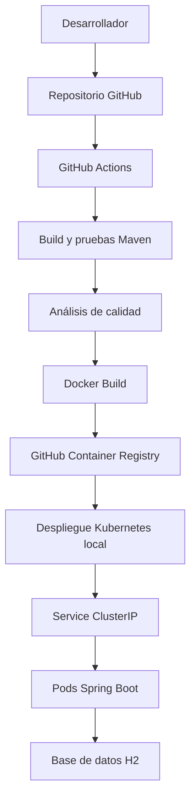
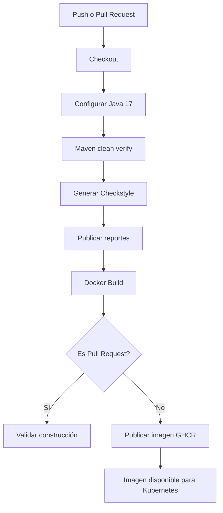

# Devsu DevOps Technical Challenge

Solución de la prueba técnica DevOps utilizando Java 17, Spring Boot,
Maven, Docker, GitHub Actions, GitHub Container Registry y Kubernetes.

## 1. Descripción del proyecto

Este proyecto parte de la aplicación demo-devops-java proporcionada
por Devsu.

La aplicación expone una API REST para la gestión de usuarios y
utiliza una base de datos H2.

El objetivo del ejercicio es implementar prácticas DevOps para
automatizar la construcción, las pruebas, el análisis de calidad,
la generación de imágenes Docker y el despliegue en Kubernetes.

Repositorio:
https://github.com/AlexEscobar97/devsu-devops-technical-challenge

## 2. Tecnologías utilizadas

| Tecnología | Utilización |
|---|---|
| Java 17 | Desarrollo backend |
| Spring Boot 3.0.5 | API REST |
| Maven | Compilación y pruebas |
| H2 | Base de datos de demostración |
| Docker | Contenedorización |
| GitHub Actions | Automatización CI/CD |
| GitHub Container Registry | Registro de imágenes |
| Kubernetes | Orquestación de contenedores |
| Docker Desktop | Clúster Kubernetes local |
| JaCoCo | Cobertura de pruebas |
| Checkstyle | Análisis estático |
| Actuator | Monitoreo de salud |

## 3. Arquitectura de la solución



El código fuente se mantiene en GitHub.

GitHub Actions ejecuta las pruebas y genera la imagen Docker,
que posteriormente se publica en GitHub Container Registry.

El despliegue Kubernetes se realiza en un clúster local
proporcionado por Docker Desktop.

## 4. Estructura del proyecto

```text
.github/workflows/
    ci-cd.yml

k8s/
    deployment.yaml
    service.yaml
    hpa.yaml

src/
    main/
    test/

doc/
    evidencias/

Dockerfile
.dockerignore
.gitignore
pom.xml
README.md
```

## 5. Ejecución local

### Requisitos

- Java 17
- Maven
- Docker Desktop
- Git
- kubectl
- Kubernetes habilitado en Docker Desktop

### Clonar el repositorio

```bash
git clone https://github.com/AlexEscobar97/devsu-devops-technical-challenge.git
cd devsu-devops-technical-challenge
```

### Compilar y ejecutar las pruebas

```bash
mvn clean verify
```

### Ejecutar la aplicación

```bash
mvn spring-boot:run
```

Swagger UI:

http://localhost:8000/api/swagger-ui.html

## 6. API REST

La aplicación proporciona los siguientes endpoints:

| Método | Endpoint | Descripción |
|---|---|---|
| POST | /api/users | Crear usuario |
| GET | /api/users | Consultar usuarios |
| GET | /api/users/{id} | Consultar usuario por ID |

Ejemplo de creación de usuario:

```json
{
  "dni": "12345678",
  "name": "Usuario Demo"
}
```

La aplicación incluye manejo de errores para solicitudes inválidas
y recursos no encontrados.

## 7. Docker

La aplicación se empaqueta mediante un Dockerfile que permite
construir una imagen ejecutable con Java 17.

La imagen se publica en GitHub Container Registry.

### Construcción local

```bash
docker build -t devsu-demo-java:latest .
```

### Descargar imagen publicada

```bash
docker pull ghcr.io/alexescobar97/devsu-devops-technical-challenge:latest
```

### Ejecutar contenedor

```bash
docker run --rm -p 8000:8000 \
  ghcr.io/alexescobar97/devsu-devops-technical-challenge:latest
```

### Verificar salud

```bash
curl http://localhost:8000/api/actuator/health
```

## 8. Integración continua y entrega continua

El pipeline se encuentra definido en:

.github/workflows/ci-cd.yml

Se ejecuta automáticamente cuando se realizan cambios en main
y cuando se crean pull requests dirigidos a main.

También permite ejecución manual mediante workflow_dispatch.

### Flujo CI/CD



### Build y pruebas

Se ejecuta:

```bash
mvn -B clean verify
```

### Análisis estático

Se genera el reporte de Checkstyle mediante:

```bash
mvn -B checkstyle:checkstyle
```

### Cobertura de código

JaCoCo permite generar reportes de cobertura de pruebas.

Los reportes se encuentran entre los artefactos del pipeline,
cuando se generan correctamente.

### Publicación Docker

Las imágenes se publican con dos etiquetas:

- latest
- SHA del commit

Esto permite identificar la versión de código correspondiente
a cada imagen.

### Evidencia del pipeline

https://github.com/AlexEscobar97/devsu-devops-technical-challenge/actions/runs/38203353082

## 9. Kubernetes

La aplicación se despliega en Kubernetes mediante manifiestos YAML.

### Deployment

Archivo:

k8s/deployment.yaml

Configuración:

- Dos réplicas iniciales.
- Imagen publicada en GHCR.
- Puerto de aplicación 8000.
- Startup probe.
- Readiness probe.
- Liveness probe.
- Solicitudes de CPU y memoria.
- Límites de CPU y memoria.

### Service

Archivo:

k8s/service.yaml

Se utiliza un servicio ClusterIP para comunicación interna
en el clúster.

Puerto: 8000/TCP.

### Horizontal Pod Autoscaler

Archivo:

k8s/hpa.yaml

Configuración:

- Mínimo: 2 réplicas.
- Máximo: 4 réplicas.
- Objetivo de CPU: 70%.

El funcionamiento automático requiere Metrics Server y
capacidad suficiente en el clúster.

## 10. Despliegue en Kubernetes local

### Verificar contexto

```bash
kubectl config current-context
```

El contexto utilizado es:

docker-desktop

### Verificar nodo

```bash
kubectl get nodes
```

### Aplicar manifiestos

```bash
kubectl apply -f k8s/
```

### Verificar Deployment

```bash
kubectl get deployments
```

### Verificar Pods

```bash
kubectl get pods
```

### Verificar Service

```bash
kubectl get services
```

### Verificar escalamiento horizontal

```bash
kubectl get hpa
```

### Verificar despliegue

```bash
kubectl rollout status deployment/devsu-java --timeout=360s
```

## 11. Acceso a la aplicación

El servicio Kubernetes es de tipo ClusterIP.

Para acceder desde la computadora local:

```bash
kubectl port-forward service/devsu-java-service 8080:8000
```

La aplicación queda disponible en:

http://localhost:8080

Este acceso funciona únicamente mientras se mantenga
activo el port-forward.

No constituye una URL pública.

## 12. Health Checks

Spring Boot Actuator permite comprobar la disponibilidad
de la aplicación.

### Estado general

```text
GET http://localhost:8080/api/actuator/health
```

Resultado verificado:

```json
{
  "status": "UP"
}
```

### Liveness

```text
GET http://localhost:8080/api/actuator/health/liveness
```

Resultado:

```json
{
  "status": "UP"
}
```

### Readiness

```text
GET http://localhost:8080/api/actuator/health/readiness
```

Resultado:

```json
{
  "status": "UP"
}
```

Las probes de Kubernetes permiten detectar cuándo un
contenedor está disponible para recibir tráfico y cuándo
requiere reiniciarse.

## 13. Evidencias de ejecución

Las capturas de las verificaciones se incluyen en:

doc/evidencias/

Evidencias previstas:

1. Repositorio público GitHub.
2. Pipeline GitHub Actions exitoso.
3. Docker Build and Push.
4. Pruebas y análisis de calidad.
5. Pods Kubernetes.
6. Deployment con dos réplicas.
7. Health checks.
8. Horizontal Pod Autoscaler.
9. Despliegue Kubernetes en CI/CD, si se implementa.

## 14. Consideraciones para producción

La solución utiliza un clúster Kubernetes local para
demostrar el funcionamiento de los recursos.

Para un entorno productivo se recomienda:

- Utilizar imágenes Docker versionadas e inmutables.
- Implementar un registro de imágenes con controles de acceso.
- Administrar credenciales mediante Secrets o un gestor externo.
- Separar configuraciones mediante ConfigMaps.
- Implementar Ingress y certificados TLS.
- Utilizar una base de datos externa persistente.
- Configurar almacenamiento persistente cuando corresponda.
- Centralizar logs y métricas.
- Implementar monitoreo y alertas.
- Establecer estrategias de rollback.
- Utilizar políticas de seguridad y mínimos privilegios.
- Gestionar despliegues con credenciales de corta duración.
- Separar entornos de desarrollo, pruebas y producción.

### Limitaciones del entorno de demostración

El clúster Kubernetes se ejecuta localmente mediante Docker Desktop.

El acceso a la aplicación se realiza mediante kubectl port-forward,
por lo que no existe una URL pública permanente.

La base de datos H2 se utiliza con fines demostrativos y
no representa una arquitectura de persistencia distribuida
adecuada para producción.

La publicación de imágenes Docker se realiza automáticamente
mediante GitHub Actions.

El despliegue Kubernetes local se ha validado manualmente.
Su integración automatizada en el pipeline se documentará
cuando se implemente y verifique.

## 15. Resultados obtenidos

Se ha verificado:

- Construcción de la aplicación Java.
- Ejecución exitosa del pipeline CI.
- Construcción de la imagen Docker.
- Publicación en GitHub Container Registry.
- Despliegue local en Kubernetes.
- Dos réplicas disponibles.
- Pods en estado Running.
- Health checks con estado UP.

## 16. Licencia

Aplicación base proporcionada por Devsu para la prueba técnica.

Copyright © 2023 Devsu. All rights reserved.
